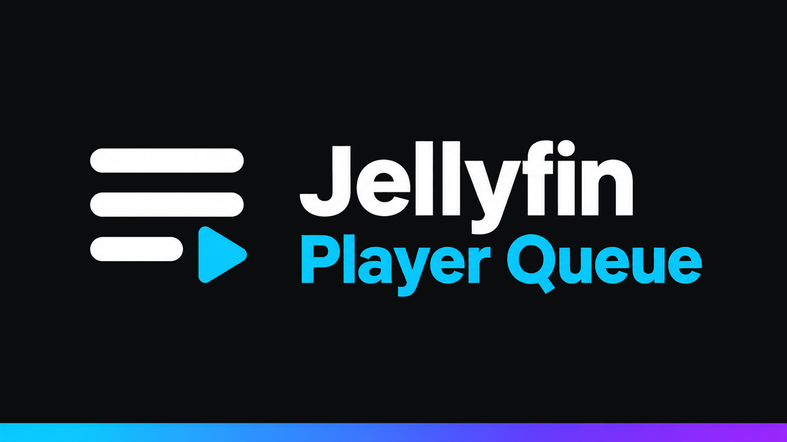
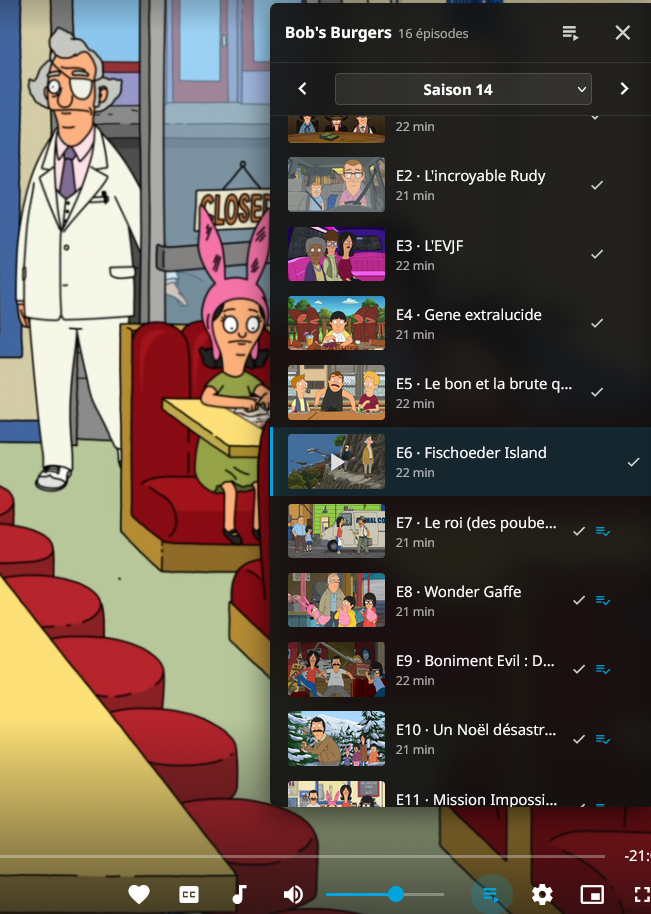
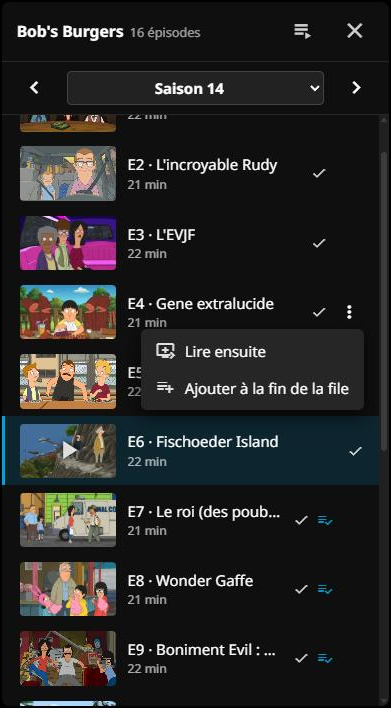
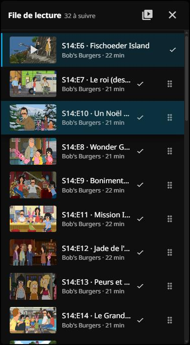
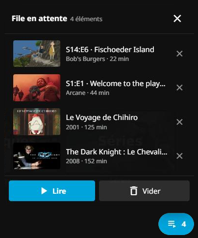

<p align="center">
  
</p>

<p align="center">
  <a href="https://github.com/k1k4k/jellyfin-player-queue/releases/latest"></a>
  
  <a href="https://github.com/k1k4k/jellyfin-player-queue/releases"></a>
  <a href="LICENSE"></a>
</p>

<p align="center">
  <b>La file de lecture qui manquait au lecteur web de Jellyfin.</b><br>
  Voir la suite, changer de saison, réordonner, ajouter, retirer, sans quitter la vidéo.
</p>

<p align="center">
  <a href="#installation">Installation</a> ·
  <a href="#fonctionnalités">Fonctionnalités</a> ·
  <a href="#dépannage">Dépannage</a> ·
  <a href="README.md">English version</a>
</p>

<p align="center"></p>

## Fonctionnalités

### Dans le lecteur

Un bouton  à côté de la roue crantée (raccourci `Q`) ouvre le panneau.

- **Séries à la Netflix** : la saison en cours, épisodes précédents compris, avec `◀ Saison N ▶` pour changer de saison. L'épisode en cours est surligné ; vignettes, coche « vu » et progression comme dans la bibliothèque.
- **Un clic, ça joue** : un épisode déjà dans la file est lu sans toucher à la file ; un autre (épisode précédent, autre saison) relance la lecture à partir de lui, jusqu'à la fin de la série.
- **Menu `⋮`** sur chaque épisode : *Lire ensuite*, *Ajouter à la fin*, *Retirer*. Une coche bleue marque ce qui est déjà prévu.
- **Vue file** : réordonner par glisser-déposer, à la souris ou au doigt.

### Dans la bibliothèque

- **File en attente** : *Ajouter à la file d'attente* et *Lire ensuite* fonctionnent même quand rien ne joue. Épisodes, films, saisons, séries, collections s'empilent ; une pastille en bas à droite ouvre la liste, et **Lire** lance exactement cette sélection (200 éléments maximum).
- **Collections dans l'ordre chronologique** plutôt que dans l'ordre d'ajout à la bibliothèque.
- **« Tout lire à partir d'ici » sur une saison** démarre vraiment à cette saison (Jellyfin repart sinon du premier épisode de la série).

### Partout

- **SyncPlay** : chaque action passe par le groupe, et le panneau suit les changements faits par les autres participants.
- Respecte le réglage Jellyfin « Lire automatiquement l'épisode suivant ».
- En français ou en anglais selon la langue du navigateur.

### Réglages

**Paramètres → File de lecture (Player Queue)**, enregistrés avec votre compte pour vous suivre sur tous vos appareils :

- **Comportement** : désactiver n'importe lequel des changements ci-dessus (file en attente, collections chronologiques, « Tout lire à partir d'ici », « Lire ensuite » limité à un épisode) pour retrouver le fonctionnement d'origine de Jellyfin.
- **Panneau** : vue à l'ouverture (saisons ou file), emplacement, largeur, densité, opacité du fond, vignettes, épisodes déjà vus (normaux, grisés ou masqués), numéros d'épisode (E4, S14:E4 ou titre seul), heure de fin de la file.
- **Divers** : raccourci clavier, préchargement des autres saisons, confirmation avant de vider la file en attente.

L'administrateur du serveur fixe la taille maximale de la file en attente dans la page du plugin.

<table>
  <tr>
    <td align="center" valign="top"><br><sub>Menu <code>⋮</code></sub></td>
    <td align="center" valign="top"><br><sub>Vue file, glisser-déposer</sub></td>
    <td align="center" valign="top"><br><sub>File en attente</sub></td>
  </tr>
</table>

## Installation

### Plugin (recommandé)

1. **Tableau de bord → Extensions → Gérer les dépôts → `+`**, puis l'adresse du dépôt de plugins k1k4k qui correspond à votre Jellyfin :

   | Jellyfin | Adresse du dépôt |
   |---|---|
   | 12.x | `https://k1k4k.github.io/jellyfin-plugins/manifest.json` |
   | 10.11.x | `https://k1k4k.github.io/jellyfin-plugins/manifest-10.11.json` |

   Ce dépôt liste tous les plugins k1k4k ([Background Play](https://github.com/k1k4k/jellyfin-background-play), Player Queue…). Vous aviez ajouté l'ancienne adresse `jellyfin-player-queue/main/manifest….json` ? Elle reste valable et liste aussi les autres plugins.

2. **Extensions → Disponible → Jellyfin Player Queue → Installer**, puis redémarrez Jellyfin.
3. `Ctrl+F5` dans le navigateur.

Le plugin injecte le script à chaque chargement de la page : aucun fichier de Jellyfin n'est modifié, et rien n'est à refaire après une mise à jour de Jellyfin, y compris en Docker. Les nouvelles versions arrivent par le tableau de bord. La page de configuration du plugin permet de désactiver le bouton sans désinstaller.

<details>
<summary><b>Autres méthodes (sans le dépôt, ou sans plugin)</b></summary>

#### Plugin, à la main

Téléchargez le zip de la [dernière version](https://github.com/k1k4k/jellyfin-player-queue/releases/latest) (`_jf12` pour Jellyfin 12, `_jf10` pour 10.11), dézippez-le dans `<config>/plugins/QueueOsd/` et redémarrez Jellyfin.

#### JavaScript Injector

Si vous utilisez déjà [JavaScript Injector](https://github.com/n00bcodr/Jellyfin-JavaScript-Injector) : ajoutez un script et collez le contenu de [`jellyfin-queue-osd.js`](jellyfin-queue-osd.js).

#### Script d'installation

Copie le `.js` dans le dossier web de Jellyfin et ajoute une balise `<script>` dans `index.html` (sauvegarde créée la première fois).

> [!WARNING]
> Une mise à jour de Jellyfin remplace `index.html` : il faut relancer le script. **En Docker, chaque mise à jour de l'image efface l'installation** : préférez le plugin.

```powershell
# Windows
.\install.ps1                                   # détection automatique
.\install.ps1 -WebDir "\\SERVEUR\jellyfin\web"  # dossier local ou partage réseau
.\install.ps1 -Uninstall
```

```bash
# Linux
sudo ./install.sh                               # détection automatique
sudo ./install.sh /usr/share/jellyfin/web
```

Si `index.html` n'est pas modifiable mais que le dossier l'est (dossier web partagé en Samba, fichier appartenant à root), `install.ps1` met l'original de côté en `index.html.queueosd.orig` ; `-Uninstall` le restaure.

#### À la main

Copiez `jellyfin-queue-osd.js` à côté de `index.html` dans le dossier web, et ajoutez juste avant `</head>` :

```html
<script defer="defer" src="jellyfin-queue-osd.js"></script>
```

</details>

## Compatibilité

| | |
|---|---|
| **Jellyfin 12.x** | testé (12.1.0) |
| **Jellyfin 10.11** | plugin compilé, non testé |
| **Navigateur** (bureau, mobile) | oui |
| **Applications qui affichent l'interface web** (Jellyfin Media Player, appli Android) | devrait fonctionner, non testé |
| **Applications natives** (Android TV, Swiftfin, Findroid…) | non : elles n'utilisent pas le lecteur web |
| **Télécommande / mode TV** | pas encore |

Le script ne modifie pas Jellyfin : il retrouve le lecteur interne par son contenu, il n'est donc pas lié à un build précis.

## À venir

- **Plus de langues** : l'interface existe aujourd'hui en français et en anglais. D'autres traductions sont prévues, et vous pourrez ajouter votre propre fichier de langue sans attendre une nouvelle version.
- **Plus d'options pour l'administrateur** : des valeurs par défaut pour tout le serveur, et la possibilité de verrouiller les réglages qui chargent le serveur.

Idées et demandes bienvenues dans les [issues](https://github.com/k1k4k/jellyfin-player-queue/issues).

## Dépannage

- **Pas de bouton dans le lecteur** : ouvrez la console du navigateur (`F12`). Vous devez y voir `[PlayerQueue] v… – playbackManager found`. Si c'est `playbackManager not found`, votre version de Jellyfin n'est pas reconnue : [ouvrez une issue](https://github.com/k1k4k/jellyfin-player-queue/issues) en l'indiquant.
- **Rien dans la console** : le script n'est pas chargé. Videz le cache (`Ctrl+F5`). Avec le script d'installation, vérifiez la balise dans `index.html` et relancez l'installation après chaque mise à jour de Jellyfin.
- **« Aucun élément dans la file »** : un film seul a été lancé, il n'y a pas de suite.
- **La file s'affiche au lieu des saisons** : la console affiche `[PlayerQueue] refresh {…}` avec `mode: "queue"`. Ouvrez une issue avec cette ligne.

<details>
<summary><b>Développement</b></summary>

#### Script client

Le script se teste sur un banc d'essai local, `web-dev/` : une copie de l'interface web de Jellyfin servie depuis votre machine, qui parle à un vrai serveur Jellyfin. Le serveur lui-même n'est jamais modifié. Ce dossier n'est pas dans le dépôt (c'est le code de Jellyfin, et sa configuration contient l'adresse de votre serveur) ; on le crée une fois :

1. Copiez le dossier web de Jellyfin (celui qui contient `index.html`) dans `web-dev/`. Il se trouve dans `C:\Program Files\Jellyfin\Server\jellyfin-web` sous Windows, `/usr/share/jellyfin/web` sous Linux, `/jellyfin/jellyfin-web` dans l'image Docker officielle. Prenez la même version de Jellyfin que votre serveur.
2. Dans `web-dev/config.json`, mettez `"multiserver": true` et l'adresse de votre serveur dans `"servers"`, par exemple `["http://192.168.1.10:8096"]`.
3. Copiez `jellyfin-queue-osd.js` dans `web-dev/`, et dans `web-dev/index.html` ajoutez juste avant `</head>` :
   ```html
   <script defer="defer" src="jellyfin-queue-osd.js"></script>
   ```
4. Servez le dossier, puis ouvrez `http://localhost:8098` et connectez-vous :
   ```powershell
   python -m http.server 8098 --directory web-dev --bind 127.0.0.1
   ```

Après chaque modification du script, recopiez-le dans `web-dev/` et rechargez avec `Ctrl+F5`.

#### Plugin

`Jellyfin.Plugin.QueueOsd/` : une source, deux cibles, `-p:JellyfinTarget=jf12` (Jellyfin 12, .NET 10, par défaut) et `jf10` (Jellyfin 10.11, .NET 9). `jellyfin-queue-osd.js` est embarqué tel quel. Sans SDK local :

```bash
docker run --rm -v "$PWD:/src" -w /src mcr.microsoft.com/dotnet/sdk:10.0 dotnet build Jellyfin.Plugin.QueueOsd/Jellyfin.Plugin.QueueOsd.csproj -c Release -o out/jf12
```

#### Publier une version

1. Mettre à jour `VERSION` dans `jellyfin-queue-osd.js` et `<Version>` / `<AssemblyVersion>` dans le csproj.
2. `git tag vX.Y.Z && git push origin vX.Y.Z` : le workflow **Release** compile les deux cibles, publie la release et met à jour les manifestes sur `main`. Le dépôt central [`jellyfin-plugins`](https://github.com/k1k4k/jellyfin-plugins) les reprend à son passage suivant (toutes les heures, ou tout de suite avec le secret `PLUGINS_REPO_TOKEN`).
3. Le workflow **Sync manifests** (toutes les heures) recopie les autres plugins k1k4k du dépôt central dans les manifestes de ce dépôt, pour que l'ancienne adresse continue de les lister.

</details>

## Licence

MIT, voir [LICENSE](LICENSE).
